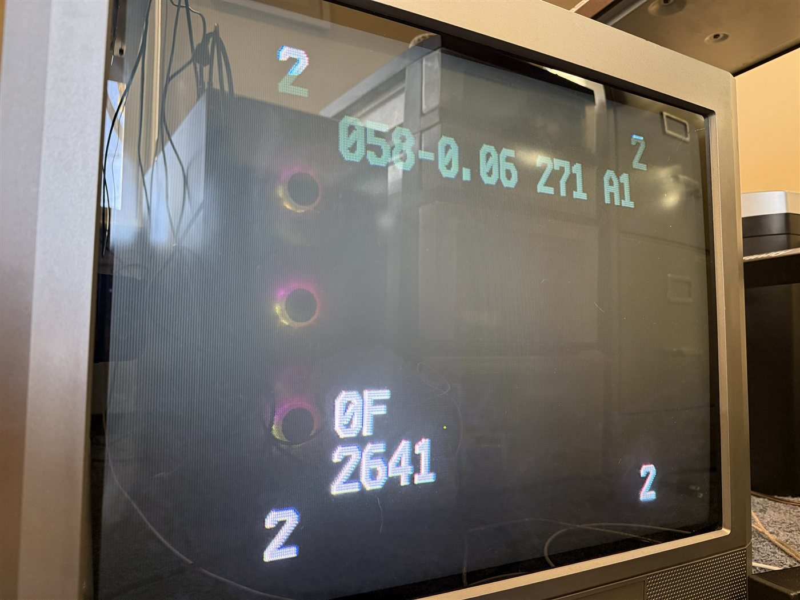
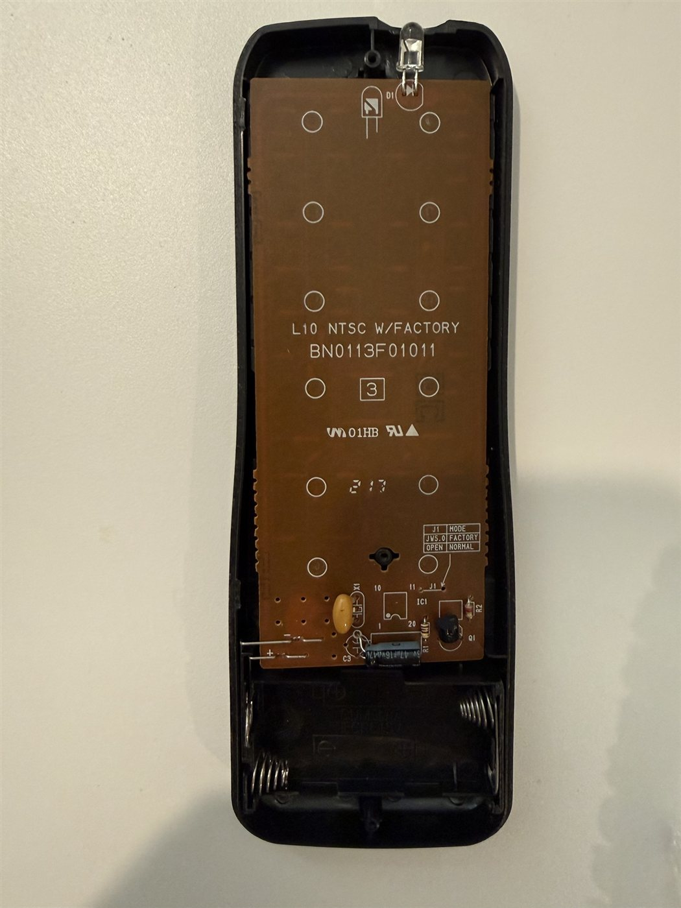

# Emerson EWF2004 / Funai CRT service remote codes

Service-mode ("factory") remote codes for the **Emerson EWF2004 / EWF2004A** 20" CRT TV,
built by Funai around 2005, plus an Arduino Uno IR transmitter and tools to send them.
The same remote family and service procedure is used across many Funai-built sets
sold as Emerson, Sylvania, Symphonic and Durabrand, so this probably applies to more models,
but it has only been tested on an EWF2004A.

Service mode is where picture geometry (horizontal position, vertical size and position)
is adjusted. Officially it needs the original remote with a jumper added. These sets
are usually found without one, and nobody had published the codes it sends.

## Short version

- **Enter service mode:** normal Emerson frame, device **41**, function **63**.
  This is what the jumpered remote's SLEEP key sends.
- **Every other key in service mode** uses a *different frame format*. The second half
  of the frame **repeats** the device and function instead of sending their complements:

  ```
  normal:   {36.7k,872}<1,-1|1,-3>(4,-4,D:6,F:6,~D:6,~F:6,1,-39)+    (JP1 "Emerson")
  factory:  {36.7k,872}<1,-1|1,-3>(4,-4,D:6,F:6, D:6, F:6,1,-39)+
  ```

  In service mode the TV ignores all normal-format codes, which is why sweeping
  all 4,096 normal device/function pairs found nothing beyond the entry code.
- Function numbers are the same as the normal remote's, on device 41:

| Key | Function | Service-mode use (from the manual) |
|---|---|---|
| SLEEP | 63, *normal format* | Enter service mode |
| 8 | 39 | H-P (horizontal position) |
| 9 | 40 | V-S / V-P (vertical size / position), press again to switch |
| CH up / CH down | 16 / 8 | Change the selected value |
| MENU | 47 | Step through picture settings |
| VOL down | 49 | Step through initial settings |
| CH RETURN | 14 | (part of a software reset with key 5, don't) |
| DISPLAY | 15 | |

Exit and save: switch the TV off and on with its own power button.

Ready-made codes:
- [`codes/emerson_ewf2004_service.ir`](codes/emerson_ewf2004_service.ir): Flipper Zero file (raw signals).
- [`codes/emerson_ewf2004_service_pronto.txt`](codes/emerson_ewf2004_service_pronto.txt): Pronto hex, for
  Broadlink, Home Assistant, Harmony and other IR blasters that accept Pronto codes.
- `python host/remote.py factory 8` sends them from the Uno build below.

The other number keys (0–7) are included in the files using the same rule but weren't captured from
the real remote. In the manual, 1–7 open non-geometry items (SD check, white balance,
cut-off and so on). Leave those alone unless you know what you're doing.

## Using it

**Warm the set up for 20+ minutes. Write down or photograph every value before you change it.**

1. Power the TV on, send *Service_mode_enter*. The screen shows the software version
   (`058-0.06 271 A1` on this set), `0F` over `2641` lower left, and a `2` near each corner.

   

2. Send factory **8** for H-P, or factory **9** for V-S then V-P. Note the value.
3. Send factory **CH up / CH down** one step at a time and watch the picture move.
4. Switch the TV off and on at its power button to save and exit.

The front panel's MENU and VOL buttons also work in service mode, and step through the
picture and initial settings. There's no width, linearity or pincushion setting on this
chassis. Those are set inside the TV, which is a job for someone who knows CRT safety.

## Making a service remote from an original remote

Original remotes listed for the EWF2004 are NE116UD, NE122UD, N0132UD, NE121UD and NE154UD.
The one used here was sold as N0132UD / NE142UD. Its board (BN0113F01011, marked
"L10 NTSC W/FACTORY") has the jumper printed on it:

| J1 | MODE |
|---|---|
| JW5.0 (5 mm wire link) | FACTORY |
| OPEN | NORMAL |

J1 is two empty holes next to the chip, by pin 11, near the transistor at the battery end. Solder
a short wire link across them. Generic "replacement" clone remotes probably won't have this.



## Universal and learning remotes

- **Learning remotes and IR blasters** (Flipper Zero, Broadlink, Harmony, Sofabaton, ESPHome
  `remote_transmitter`, anything that takes raw or Pronto codes) can send the files above directly.
  You don't need the original remote.
- **Ordinary pre-programmed universal remotes** send only the normal Emerson format, so they can't
  work the service menu. They also don't send function 63, so they can't enter it either.
- **JP1 remotes** (One For All / URC, programmed with RemoteMaster) can in principle be given a
  custom protocol or a learned signal. Not tried.

## How this was found

The full log is in [`NOTES.md`](NOTES.md). In short: the Uno found the normal device code, a scan of
unassigned functions found the entry code, and then exhaustive scans (both TV states, webcam-checked)
showed nothing else in the normal format worked. Recording an original remote before and after linking
J1 showed the different frame layout.

## The transmitter

Arduino Uno (or ESP32) with an IR LED and an optional TSOP38238 receiver.

### Parts

| Part | Notes |
|---|---|
| Arduino Uno (or ESP32 dev board) | The firmware builds for either; the Uno is the default |
| 940 nm IR LED, 5 mm | e.g. Adafruit 387. Buy a few. |
| PN2222 (or 2N2222 / 2N3904) NPN transistor | Drives the LED harder than a pin can |
| 1 kΩ resistor | Transistor base |
| 51–68 Ω resistor, ¼ W | LED current limit, ~45–60 mA peak from 5 V. A single 51 Ω works, as does 100 Ω ∥ 200 Ω (66.7 Ω). |
| TSOP38238 IR receiver *(optional, recommended)* | Lets you verify your own transmissions and capture any Funai remote later |
| Breadboard and jumper wires | |

### Wiring (Uno)

```
5V ──[51Ω]──►|── IR LED ──┐             (LED long leg = anode, toward 5V)
                          C
D3 ──[1kΩ]────────── B  PN2222   (flat face toward you, legs down: E B C)
                          E
GND ──────────────────────┘

TSOP38238 (optional, dome facing you, legs down: OUT GND VS)
  OUT → D11    GND → GND    VS → 5V
```

**ESP32 instead:** LED circuit from 3V3 with a 33 Ω resistor, base resistor to GPIO4, receiver OUT to GPIO15 and VS to 3V3. Build with `-e esp32dev`.

### Setup

```powershell
# firmware (PlatformIO; plug the Uno in first)
cd firmware
python -m platformio run -t upload            # Uno
python -m platformio run -e esp32dev -t upload   # ESP32

# host tools
cd ..\host
python -m pip install -r requirements.txt
python test_emerson.py        # protocol self-test against a real Funai capture
```

`remote.py` auto-detects the board's serial port. If it picks the wrong one, pass `--port COM5` or set `EMERSON_PORT`.

### Serial protocol

115200 baud, one command per line. Each reply is `OK …` or `ERR …`.

| Command | Meaning |
|---|---|
| `E <device> <function> [frames]` | Emerson/Funai CRT frame, device/function 0–63, default 2 frames |
| `N <address> <command> [repeats]` | NEC/NECext |
| `R <freq_hz> <t1> <t2> …` | raw mark/space µs, e.g. to replay a captured factory remote |
| `L <0\|1>` | turn printing of received IR as `RAW …` lines off or on |
| `PING` | health check |

## Licence

Code: MIT (see [`LICENSE`](LICENSE)). The IR codes, `codes/` files and notes are public domain (CC0),
so copy them into IR databases freely.
`reference/Symphonic_ST424FF.ir` is from [Flipper-IRDB](https://github.com/Lucaslhm/Flipper-IRDB) (CC0).
The service manual is on [ManualsLib](https://www.manualslib.com/manual/553858/Emerson-20-Color-Television-6420fe.html)
(Emerson 6420FE / EWF2004, service mode on pp. 15–19).
